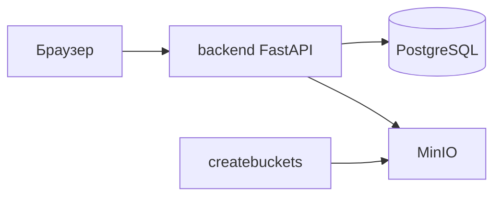

# Архитектура

YouTube Clone — сервис загрузки, каталога и просмотра видео. Браузер говорит только с FastAPI. Метаданные лежат в PostgreSQL, байты файлов — в MinIO.

## Стек

| Часть | Технология |
| --- | --- |
| API | Python 3.11, FastAPI, Pydantic v2 |
| База | PostgreSQL 16, SQLAlchemy 2.0 async, драйвер asyncpg |
| Миграции | Alembic, одна линейная ветка ревизий |
| Файлы | MinIO, официальный SDK `minio` |
| Токены | JWT (HS256), access и refresh |
| Пароли | bcrypt через passlib |
| UI | Статические HTML/CSS/JS, их отдаёт тот же процесс |
| Запуск | Docker Compose: `db`, `minio`, `createbuckets`, `backend` |

## Слои

Запрос проходит сверху вниз. Роут не пишет SQL и не вызывает SDK MinIO напрямую.

```text
браузер / Swagger
        |
        v
app/api          HTTP, зависимости, коды ответов
        |
        v
app/services     правила доступа, запись метаданных, чтение объектов
        |
        +--> app/models     таблицы SQLAlchemy
        +--> app/schemas    вход и выход Pydantic v2
        +--> app/core       настройки, сессия БД, JWT, S3Storage
```

`app/api/deps.py` достаёт текущего пользователя из Bearer-токена и отдаёт сессию БД. Сервис получает уже проверенного `User` и `AsyncSession`.

## Процессы в Compose



1. `db` принимает соединения после `pg_isready`.
2. `minio` принимает соединения после `/minio/health/live`.
3. `createbuckets` один раз вызывает `S3Storage.ensure_buckets()` и создаёт бакеты `videos` и `thumbnails`, если их ещё нет. Сервис собран из того же образа, что и API.
4. `backend` стартует только после здоровых `db` и `minio` и успешного `createbuckets`.
5. `backend/docker-entrypoint.sh` выполняет `alembic upgrade head`. Если в `users` нет строк и `SEED_ON_EMPTY=true`, запускается `python -m scripts.seed_data`. Затем процесс заменяется на uvicorn.

Повторный запуск контейнера не перезаписывает демо-данные: сид выполняется только на пустой таблице пользователей. Сам скрипт идемпотентен и его можно вызвать вручную.

При старте приложения `S3Storage.ensure_buckets()` ещё раз проверяет те же два бакета. Это запасной путь, если API запускают без сервиса `createbuckets`.

## Хранение видео

В таблице `videos` хранятся название, описание, ключи объектов, длительность, счётчик просмотров, приватность, бан, категория и теги. Колонки `s3_key` и `preview_s3_key` — это ключи объектов, не пути на диске.

Загрузка `POST /videos/upload` принимает mp4 или webm и необязательную обложку jpeg, png или webp. Видео пишется в бакет `videos`, обложка — в `thumbnails`. Ключ уникален. Если запись в базу не удалась, уже загруженные объекты удаляются.

Лимиты: видео до 2 ГиБ, обложка до 8 МиБ.

## Потоковая раздача и Range

`GET /videos/{id}/stream` читает из MinIO только запрошенный диапазон байт.

- Без заголовка `Range` ответ `200`, тело — файл целиком, заголовок `Accept-Ranges: bytes`.
- С одним диапазоном вида `bytes=start-end` ответ `206 Partial Content` и заголовок `Content-Range`.
- Невыполнимый диапазон даёт `416 Range Not Satisfiable` и `Content-Range: bytes */{size}`.
- Пустой диапазон за концом файла даёт `200` с `Content-Length: 0`.

Разбор заголовка делает `parse_byte_range`. Чтение делает `S3Storage.read_object_range`, оно передаёт `offset` и `length` в `get_object` клиента MinIO. Плеер может перематывать ролик, не скачивая файл с нуля.

Обложка отдаётся отдельно: `GET /videos/{id}/thumbnail`.

## Роли и доступ

Роль хранится в PostgreSQL enum `user_role`: `user`, `moderator`, `admin`. Регистрация создаёт только `user`. Демо-персонал появляется из сида.

Аутентификация: `POST /auth/login` принимает email или username и пароль, `POST /auth/refresh` меняет refresh-токен на новую пару. Защищённые методы ждут `Authorization: Bearer`.

| Действие | user | moderator | admin |
| --- | --- | --- | --- |
| Свои видео, плейлисты, реакции, подписки, история | да | да | да |
| Жалоба на видео, которое пользователь может открыть | да | да | да |
| Белый список своего приватного видео | да | да | да |
| Удаление своего комментария | да | да | да |
| Удаление чужого комментария | нет | да | да |
| Просмотр приватного и забаненного чужого видео | нет | да | да |
| Список жалоб, отклонение жалобы, бан и разбан | нет | да | да |
| Удаление чужого видео | нет | да | да |
| Удаление чужого плейлиста | нет | нет | да |

Приватное видео (`is_private`) открывают автор, модератор, администратор и пользователь из `video_accesses`. Остальным API отвечает `403`. Запрос без токена на закрытый ролик отвечает `401`.

Забаненное видео (`is_banned`) пропадает из каталога, поиска и ленты. Карточку по-прежнему открывают автор и персонал. Бан не удаляет объект в MinIO.

Публичные списки фильтруются условием «не приватное и не забаненное». Приватный плейлист видит только его автор.

Проверка стоит в сервисах (`app/services/video.py`, `moderation.py`, `access.py`, `interaction.py`, `playlist.py`). `require_role` в `app/api/deps.py` — зависимость FastAPI для тех маршрутов, которым нужен явный список ролей.

## Основные маршруты

Префикса `/api` нет. Контракт совпадает с тем, что показывает Swagger.

| Группа | Методы |
| --- | --- |
| Служебные | `GET /health`, `GET /docs` |
| Auth | `/auth/register`, `/auth/login`, `/auth/refresh`, `/auth/me` |
| Видео | `/videos`, `/videos/upload`, `/videos/{id}`, `/videos/{id}/stream`, `/videos/{id}/thumbnail`, `DELETE /videos/{id}` |
| Просмотры и поиск | `POST /videos/{id}/view`, `GET /videos/search`, `GET /videos/tags/trending` |
| Реакции и комментарии | `/videos/{id}/reaction`, `/videos/{id}/reactions`, `/videos/{id}/comments`, `DELETE /comments/{id}` |
| Доступ | `/videos/{id}/access`, `DELETE /videos/{id}/access/{user_id}` |
| Подписки и канал | `/users/{id}/subscribe`, `/users/{id}/subscription`, `/users/{id}/subscribers/count`, `/channels/{id}` |
| Лента и история | `GET /feed/subscriptions`, `/users/me/history` |
| Плейлисты | `/playlists`, `/users/{id}/playlists` |
| Модерация | `POST /videos/{id}/report`, `/moderation/reports`, бан и разбан |

Веб-интерфейс — это `frontend/`, смонтированный в `/` после регистрации API. Маршруты `/docs`, `/auth`, `/videos` и остальные API поэтому не перекрываются статикой.

## Конфигурация

`app/core/config.py` читает переменные окружения и файл `.env`. В Compose хост базы — имя сервиса `db`, хост MinIO — `minio:9000` без схемы. Схема `http://` или `https://` в `MINIO_ENDPOINT` допустима: `normalize_minio_endpoint` снимает её и выставляет TLS.
