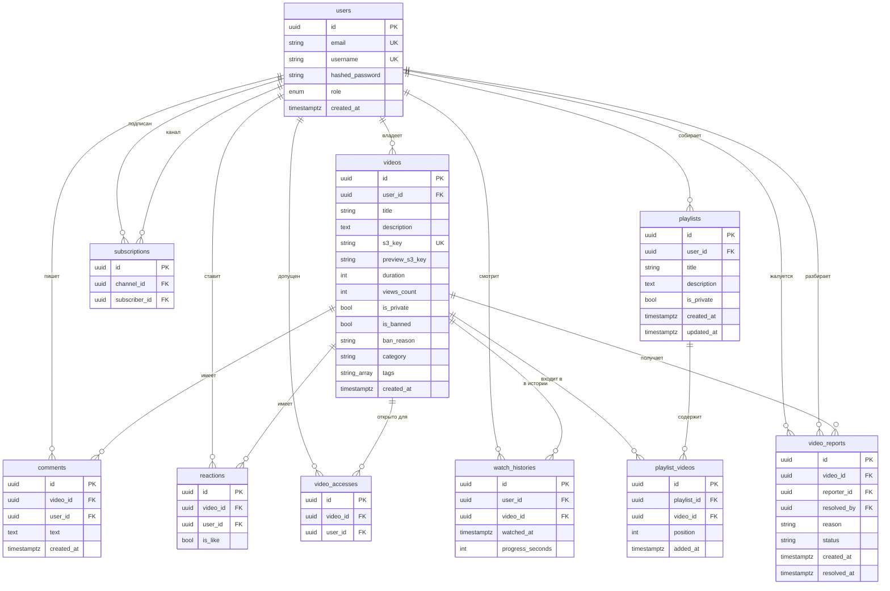

# База данных

СУБД — PostgreSQL 16. Модели — SQLAlchemy 2.0 (`Mapped`, `mapped_column`). Имена ограничений задаёт соглашение в `app/models/base.py`:

| Тип | Шаблон |
| --- | --- |
| Первичный ключ | `pk_<таблица>` |
| Внешний ключ | `fk_<таблица>_<колонка>_<целевая таблица>` |
| Уникальность | `uq_<таблица>_<колонка>` или явное имя составного ключа |
| Проверка | `ck_<таблица>_<имя>` |
| Индекс | `ix_<колонка>` или явное имя |

Идентификаторы — UUID, значение по умолчанию `gen_random_uuid()`. Время — `timestamptz`.

## ER-диаграмма

## Таблицы и связи

### users

Учётная запись. `email` и `username` уникальны. `role` — enum `user_role` со значениями `user`, `moderator`, `admin`, по умолчанию `user`. Пароль хранится только как bcrypt-хеш.

Удаление пользователя каскадом удаляет его видео, комментарии, реакции, подписки, плейлисты, историю, жалобы, где он автор, и строки белого списка.

### videos

Ролик. `user_id` ссылается на владельца, `ON DELETE CASCADE`. `s3_key` уникален и указывает на объект в бакете `videos`. `preview_s3_key` указывает на объект в бакете `thumbnails` и может быть пустым.

`is_private` закрывает ролик для каталога. `is_banned` и `ban_reason` — решение модерации. `category` — короткая строка фильтра. `tags` — `varchar(50)[]`, пустой массив по умолчанию.

Байты файла в этой таблице не хранятся.

### comments

Текст комментария к видео. Оба внешних ключа с `ON DELETE CASCADE`.

### reactions

Одна реакция пользователя на видео: `is_like = true` — лайк, `false` — дизлайк. Пара `(video_id, user_id)` уникальна, поэтому повторный клик обновляет или снимает ту же строку, а не плодит копии.

### subscriptions

Подписка зрителя на канал. Канал — тоже строка `users`: отдельной таблицы каналов нет. Пара `(channel_id, subscriber_id)` уникальна. Проверка `channel_id <> subscriber_id` запрещает подписку на себя. Оба ключа с `ON DELETE CASCADE`.

### video_accesses

Белый список приватного видео. Пара `(video_id, user_id)` уникальна. Строку создаёт владелец ролика. Автор, модератор и администратор открывают приватное видео и без этой строки.

### watch_histories

Последняя позиция зрителя в ролике. Пара `(user_id, video_id)` уникальна: новый просмотр обновляет `watched_at` и `progress_seconds`, а не добавляет вторую строку.

### playlists и playlist_videos

Плейлист принадлежит автору (`playlists.user_id`). `is_private` скрывает его от чужих запросов. `updated_at` выставляется при изменении состава и описания.

`playlist_videos` хранит порядок: `position` начинается с 0, проверка `position >= 0`. Одно видео входит в плейлист один раз, пара `(playlist_id, video_id)` уникальна. Оба внешних ключа с `ON DELETE CASCADE`, поэтому удаление плейлиста или видео убирает связку.

### video_reports

Жалоба. `status` — одно из `pending`, `resolved`, `rejected` (проверка на уровне таблицы). `reporter_id` удаляется каскадом вместе с пользователем. `resolved_by` при удалении сотрудника становится `NULL` (`ON DELETE SET NULL`), сама жалоба остаётся.

Бан ролика живёт на `videos.is_banned`, а не отдельной таблицей. Отклонение жалобы статус меняет, бан не ставит.

## Индексы

Помимо первичных ключей и уникальных ограничений:

| Индекс | Зачем |
| --- | --- |
| `ix_videos_user_id` | ролики канала |
| `ix_videos_category` | фильтр поиска по категории |
| `ix_videos_tags` | GIN по массиву тегов, поиск и тренды |
| `ix_videos_is_banned` | отбор скрытых роликов |
| `ix_comments_video_id`, `ix_comments_user_id` | комментарии ролика и автора |
| `ix_reactions_user_id` | реакции пользователя; пара с видео уже уникальна |
| `ix_subscriptions_subscriber_id` | лента подписок |
| `ix_video_accesses_user_id` | какие приватные ролики открыты пользователю |
| `ix_watch_histories_video_id` | история по ролику; пара с пользователем уникальна |
| `ix_playlists_user_id` | плейлисты канала |
| `ix_playlist_videos_video_id` | вхождения видео в плейлисты |
| `ix_playlist_videos_playlist_id_position` | выдача плейлиста по порядку |
| `ix_video_reports_video_id`, `ix_video_reports_reporter_id`, `ix_video_reports_status` | очередь модерации |

Уникальные пары (`uq_reactions_video_id_user_id`, `uq_subscriptions_channel_id_subscriber_id`, `uq_video_accesses_video_id_user_id`, `uq_watch_histories_user_id_video_id`, `uq_playlist_videos_playlist_id_video_id`) одновременно защищают целостность и дают поиск по этим колонкам.

Поиск по названию и описанию идёт через `ILIKE` по подстроке. Отдельного полнотекстового индекса нет: выборка публичных роликов сначала сужается флагами `is_private` и `is_banned`, категорией и GIN по тегам.

## Версионирование схемы

Схема версионируется Alembic. Текущая ревизия записана в служебной таблице `alembic_version`. Ветвлений нет, каждая ревизия указывает ровно одну предыдущую.

| Ревизия | Что добавляет |
| --- | --- |
| `2e70a054b67b` | `users`, `videos`, `comments`, `reactions`, `subscriptions`, `video_accesses`, enum `user_role` |
| `b7d3e1a84c02` | `watch_histories` |
| `c3e8b1a94f06` | `videos.category`, `videos.tags`, btree по категории и GIN по тегам |
| `d8a1c4e62b30` | `playlists`, `playlist_videos` |
| `e5c2a8d14f70` | `videos.is_banned`, `videos.ban_reason`, таблица `video_reports`. Это голова цепочки |

При старте контейнера выполняется `alembic upgrade head`: на пустой базе применяются все пять ревизий, на уже обновлённой Alembic ничего не меняет. Откат каждой ревизии описан в `downgrade()`.

Новое изменение схемы — новый файл в `backend/alembic/versions/` с `down_revision` равным текущей голове. Модели и миграция меняются вместе. `env.py` берёт URL из настроек приложения (`postgresql+asyncpg://...`) и сравнивает типы и server default.

Сами ролики не версионируются: у видео одна текущая пара ключей в MinIO. Повторная загрузка создаёт новый объект и новую строку, а не ревизию старой.
